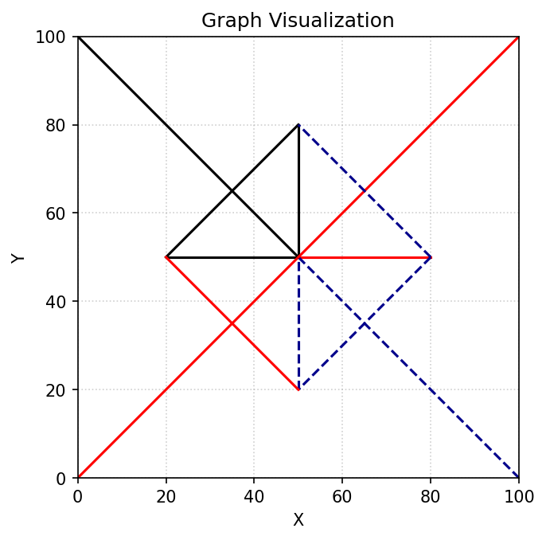
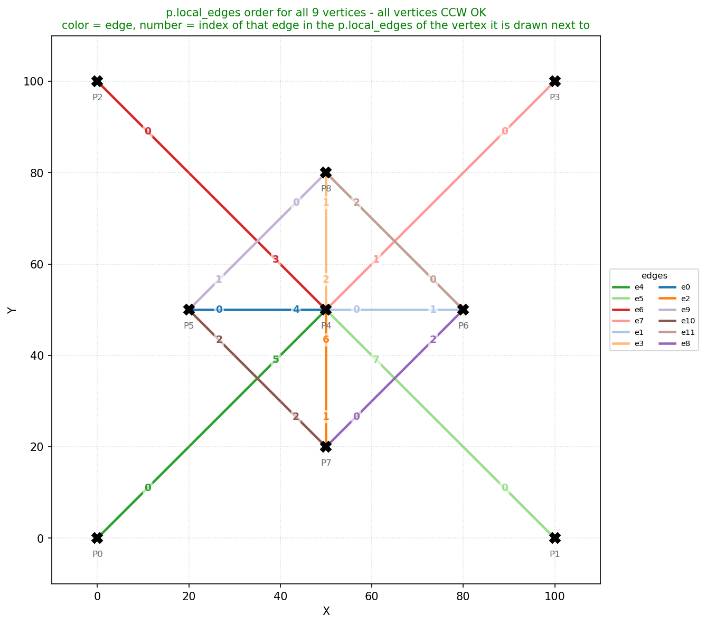
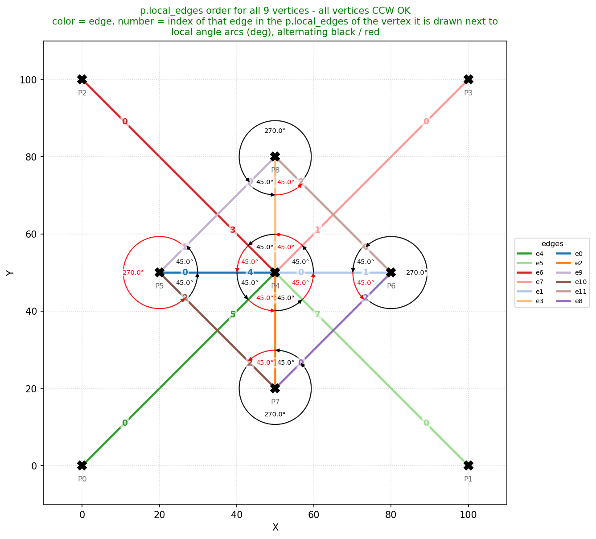

# Determining Satisfiability and Point Flat-Foldability of Origami Crease Patterns with SAT Solvers

**Course:** DCC831 Theory and Practice of SMT Solving 2026.2  
**Author:** Túlio Faustino Simões de Sousa

## Overview

The proposed project is to, given a crease pattern, determine, if satisfiable, an assignment of how the folds have to be arranged.

In origami, there are two types of folds, mountain folds (M) and valley folds (V). The set of points (P) and the set of edges (e). The edge becomes a fold once we assign a type of fold to it, be it mountain or valley.

A crease pattern is a plane, usually a square paper that has points and lines that go from point to point, and, given the assignment as said before, can be folded, ideally to a flat state.

The precise definition of everything I say briefly in here is in the literature and will be included in the final presentation and documentation.

## The Math Behind It

The interesting part of this is that the foldability of a point is decidable. That is, there is a set of rules that the folds that go through a point have to follow. Thus, there are assignments for the edges (which we, initially, do not know what type of fold they are) to make the crease be foldable.

The three verifying basis for deciding the foldability of a point are the following:

1. The sum of the angles between the folds must be $\pi$.
2. In a given point P, for every edge that goes through it, being V the set of valley fold edges and M the set of mountain fold edges, we have that:
   $$||V| - |M|| = 2$$
3. For every trio of edges, being $\alpha_{i}$ the angle for the edge $e_{i}$ to $\mathcal{c}_{i+1}$, we have:
   $$((e_{i-1} = e_{i+1}) \wedge ((\alpha_{i} < \alpha_{i-1}) \wedge (\alpha_{i} < \alpha_{i+1}))) \rightarrow (e_{i} = \neg e_{i-1})$$

That is, if the angle between $e_{i}$ and the next edge is smaller than the angle from the last edge to $e_{i}$ and smaller than the angle from the next edge to its next edge, the fold must be the contrary to both of those edges.

These sets of rules are known as Maekawa-Justin and Kawasaki-Justin theorems.

## Project Scope

The more conservative proposing of this project is to create a framework, for any given crease pattern, to produce an assignment that satisfies the rules explained above of mountain and valley folds. To do this, I intend to use already established SAT solvers such as CVC5. I am yet to familiarize myself with actually using one.

## Current progress:

The program already reads a crease pattern described as a graph and prepares the geometric data
that the SAT encoding will need. The MV assignment itself is still a placeholder.

### 1. Input

The input is a plain text file describing a graph (see `test_files/graph.in`): first the number of
points, then one `x y` line per point, then the number of edges, and finally one `u v` line per
edge, where `u` and `v` are point indices. The `test_files/graph.in` file looks like this:

```
9
0 0
100 0
0 100
100 100
50 50
20 50
80 50
50 20
50 80
12
5 4
6 4
7 4
8 4
4 0
4 1
4 2
4 3
6 7
5 8
5 7
6 8
```

### 2. What is done with it

For every point, the program

1. **collects the incident edges** into `p.local_edges` (an edge id is pushed into the list of both
   of its endpoints);
2. **sorts those edges counter-clockwise** around the point, starting from the positive x axis
   (`ccw_sort_point_edges`), so `p.local_edges[k]` is the k-th edge of that point in CCW order;
3. **computes the angle between consecutive edges** (`find_angles`): `p.local_angles[k]` is the CCW
   angle from `p.local_edges[k]` to the next one, so the gaps around a point always add up to
   $2\pi$. These are exactly the angles that the Kawasaki-Justin theorem needs.

The program then writes the pattern to `plot/instructions/*.plot`, and `scripts/graph_plotter.py`
renders it into `plot/img/*.png` (see `comp_run_instructions.txt` for the commands).

The assignment is not decided yet: for now every edge gets a type by simply cycling through
`'0'`, `'M'` and `'V'`, only so that the whole pipeline has something to draw. The SAT encoding
that will actually choose them is the next step.

### 3. How the output shows each assignment

An edge of the output is written as `<u> <v> <type>`, where `<type>` is `'0'` (no fold yet), `'M'`
(mountain) or `'V'` (valley). The plotter translates that third column into a visual style:

| type | meaning | style |
|------|---------|-------|
| `0`  | plain crease / unassigned | black solid line |
| `M`  | mountain fold | red solid line |
| `V`  | valley fold | dark blue dashed line |

So once the solver fills in the `M`/`V` column, the picture becomes the MV assignment itself:



*`plot/img/origami.png` — the crease pattern as the program outputs it today. The fold type of
each edge is read from the third column of the output file and translated into the styles above
(here the types are still the placeholder `0`/`M`/`V` cycle, not a valid assignment).*

### 4. Checking the counter-clockwise ordering

To make sure the CCW sort is right, every point is dumped with its `p.local_edges` in the current
order. In the figure below each edge is drawn once with its own color (so the same crease has the
same color seen from both of its endpoints), and the order index of an edge is written next to the
vertex that owns that ordering:



*`plot/img/ccw_test.png` — the sequence `p.local_edges[0], p.local_edges[1], ...` for all points.
Reading the numbers around a vertex should follow the counter-clockwise direction.*

### 5. Checking the angles

The same picture can also show the local angles. They are written in degrees, alternating black and
red, and each one is drawn as an arc swept counter-clockwise from one edge to the next (the arc of
a reflex gap, above 180°, wraps around the outside of the vertex):



*`plot/img/ccw_test_angles.png` — the gaps `p.local_angles` of every point. Each arc ends with a
small arrow showing the counter-clockwise direction, and the gaps of a point sum to $2\pi$.*

### 6. Still open: collisions and overlapping creases

The graph format assumes that every crease starts and ends at a point that is given in the input,
and that is not general enough yet. Two cases are still unsolved and I am thinking about how to
handle them before going further:

* **Collisions** — two edges that cross in their interior create a new point (and four new angles)
  that does not exist in the input graph. Such an intersection has to become a vertex, otherwise
  the foldability rules are applied to the wrong set of angles.
* **Overlapping lines** — two creases that lie on top of each other (fully or partially) with no
  point at the overlap. It is not clear yet whether they should be merged into a single crease,
  split at the endpoints of the overlap, or rejected as an invalid pattern.

Both cases change the graph itself, so they have to be resolved *before* the angles are computed
and before the SAT instance is built.

## Motivation & Challenges

Why am I doing this? Well, first of all, I am an origami artist! Most origami software out there is built to design models from scratch. They already follow the rules by default because making a pattern that cannot be folded does not make much sense. But especially nowadays, in the age of AI slop, I think it is super important to have a tool that can verify if a generated pattern is actually foldable. Trust me, AI is terrible at designing origami and it is flooding places like Pinterest with fake, impossible patterns.

The biggest challenge here is finding a proof. Even if we can assign mountain and valley folds (what I call an MV assignment) and prove that a single point can fold flat, proving that the *entire* model folds flat is an NP-hard problem. So, I probably won't be able to tackle the global foldability part just yet.

Having said that, for the more ambitious part of this project, I want to see if a pattern can be achieved through purely geometric folds, starting just from the four corners of the paper. I will be diving into Martin's (1998) work and other literature to figure out how to reverse engineer the pattern and find its proof. 

## References

I will be studying these papers to better understand the operations and how to reverse the pattern to find its proof. More will be added later!

* Alperin. "A mathematical theory of origami construction and numbers"
* Martin. "Geometric Constructions"
* Alperin and Lang. "One-, two-, and multi-fold origami axioms"
* Ida. "Computational Origami Construction as Constraint Solving and Rewriting"
* Huzita. "Axiomatic Development of Origami Geometry"